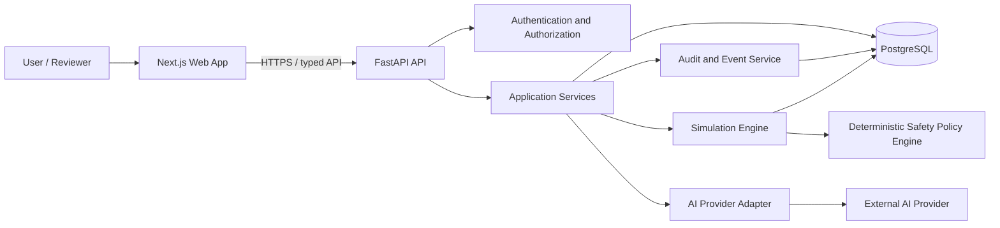
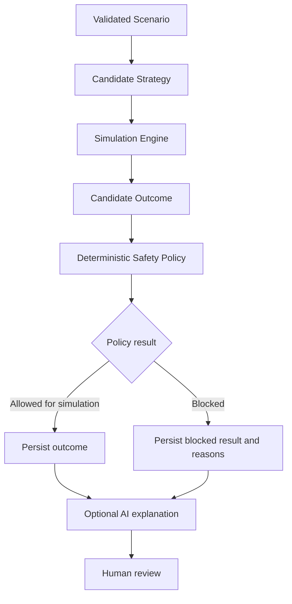

# ARSITEKTUR.md — GARDA-SIM AI
## System Architecture and Technical Design

**Status:** Proposed architecture baseline; must be validated against repository, exported Figma assets, and deployment constraints.  
**Architecture style:** Modular monolith with separately deployable web and API applications if justified.  
**Primary rule:** The simulator and deterministic safety engine remain independent of the AI provider.

> This document defines a target architecture. It does not claim that the modules or infrastructure already exist.

---

## 1. Architectural goals

1. Preserve the approved Figma UI.
2. Support public pages, authentication, and a complete authenticated web app.
3. Keep the system maintainable for a small hackathon team.
4. Make simulation outcomes traceable and reproducible.
5. Enforce safety constraints deterministically.
6. Use AI for explanation and evidence synthesis, not authoritative safety decisions.
7. Keep core simulator functionality available when an AI provider is unavailable.
8. Avoid unnecessary microservices and infrastructure.
9. Make local development, testing, and deployment repeatable.
10. Provide explicit contracts between UI, API, domain logic, persistence, and AI provider.

## 2. Proposed technology baseline

The recommended initial option is:

### Web frontend
- Next.js App Router.
- React.
- TypeScript strict mode.
- Tailwind CSS.
- shadcn/ui and Radix primitives.
- Lucide icons.
- Zod for frontend/shared validation where appropriate.
- React Hook Form for complex forms.
- TanStack Query if server-state complexity warrants it.
- Motion for React for component transitions.
- GSAP for selected complex landing-page sequences only.
- React Flow or comparable graph library for 2D topology.
- Three.js / React Three Fiber only if a specific approved design requires 3D.

### API/backend
- Python stable version compatible with the dependency set.
- FastAPI.
- Pydantic.
- SQLAlchemy 2.x.
- Alembic migrations.
- PostgreSQL.
- Pytest and HTTPX/TestClient.
- Structured logging.

### Optional infrastructure
- Redis and a worker queue only when long-running or batch simulation jobs justify them.
- Object storage only if report/artifact volume requires it.
- Containerization and CI as supported by the deployment target.

This is a recommendation, not an unconditional requirement. Inspect existing files and actual environment before committing to it. Do not use three competing web frameworks in one application. Do not introduce a distributed system for a prototype that can run as a modular monolith.

## 3. High-level system context



The AI provider adapter receives only the minimum necessary synthetic context. The safety engine must not depend on the AI provider.

## 4. Deployment topology

### MVP default
A single repository may contain:
- `apps/web`: Next.js frontend.
- `apps/api`: FastAPI backend.
- `docs`: PRD, design, architecture, contracts, ADRs, status.
- Local PostgreSQL configuration for development.
- CI scripts.

This structure is a proposal, not a command to relocate an existing repository. If the repository is already organized differently, preserve its conventions unless there is a documented reason to change them.

### Network boundaries
- Browser talks to the web app and/or API over HTTPS.
- API talks to PostgreSQL through private configuration.
- External AI provider calls originate from the backend only.
- Database must not be exposed publicly.
- Secrets are provided through environment variables or a secret manager.
- CORS is limited to the required web origin.
- Production environment must not use development seed credentials.

### Local development
Provide `.env.example` without real credentials. Provide documented commands for:
- installing dependencies,
- running migrations,
- loading synthetic seed data,
- starting web and API,
- running tests,
- running lint/type checks,
- creating a production build.

## 5. Repository structure proposal

```text
garda-sim-ai/
├── apps/
│   ├── web/
│   │   ├── app/
│   │   ├── components/
│   │   ├── features/
│   │   ├── lib/
│   │   ├── styles/
│   │   └── tests/
│   └── api/
│       ├── app/
│       │   ├── api/
│       │   ├── core/
│       │   ├── domain/
│       │   ├── services/
│       │   ├── repositories/
│       │   ├── schemas/
│       │   ├── simulation/
│       │   ├── safety/
│       │   ├── ai/
│       │   ├── audit/
│       │   └── reports/
│       ├── migrations/
│       └── tests/
├── docs/
│   ├── PRD.md
│   ├── DESIGN.md
│   ├── ARSITEKTUR.md
│   ├── SKILLS.md
│   ├── AGENTS.md
│   ├── API.md
│   ├── DATA_MODEL.md
│   ├── SECURITY.md
│   ├── IMPLEMENTATION_STATUS.md
│   └── ADR/
├── infra/
├── .env.example
├── README.md
└── ...
```

Use this only if it fits the actual repository and tooling. Avoid adding a monorepo manager unless it solves a real dependency/workspace problem.

## 6. Module responsibilities

### 6.1 Web presentation layer
Responsible for:
- Public marketing pages.
- Authentication and onboarding UI.
- Authenticated app shell.
- Screen-level composition.
- Form interaction and client-side validation.
- Loading/error/empty/success states.
- Rendering server data.
- Accessible interaction and responsive behavior.

Must not:
- Calculate authoritative simulation results.
- Enforce access control solely in the client.
- Generate fabricated evidence.
- Store secrets.
- Treat AI text as trusted instructions.

### 6.2 API layer
Responsible for:
- Request validation.
- Authentication and authorization checks.
- Routing requests to application services.
- Consistent response/error schemas.
- Pagination/filter validation.
- Correlation IDs and request-level observability.

Route handlers should remain thin. Business rules belong in service/domain modules.

### 6.3 Authentication and authorization
Responsible for:
- Registration/login/logout.
- Session lifecycle.
- Password reset and verification where configured.
- Ownership and access checks.
- Rate limiting and safe error responses.

Use a tested auth library or a carefully implemented server-side session model. Do not improvise a custom token protocol without a clear need and review.

### 6.4 Incident and evidence service
Responsible for:
- Querying incidents and associated evidence.
- Validating evidence references.
- Filtering and pagination.
- Keeping source event data distinct from derived analysis.

### 6.5 Topology service
Responsible for:
- Virtual assets.
- Directed dependencies.
- Topology versioning.
- Node/edge validation.
- Baseline topology.
- Impact graph input.

Rules:
- Every edge references existing nodes.
- Dependency semantics are documented.
- Cycle handling is explicit.
- Simulation changes must not mutate the baseline.
- Runs must identify the topology version/snapshot used.

### 6.6 Simulation engine
Responsible for deterministic evaluation of candidate response strategies.

Inputs:
- Scenario version.
- Incident context.
- Topology version/snapshot.
- Candidate strategies and parameters.
- Simulation model version.
- Optional seed if randomness is used.

Outputs:
- Per-strategy security/mitigation score according to defined formula.
- Affected services/assets.
- Estimated simulated service impact.
- Recovery effort estimate.
- Assumptions and limitations.
- Input/version metadata.
- Status and error information.

The engine must be testable without an AI provider. Metrics and formulas must be documented before results are described as meaningful.

### 6.7 Deterministic safety policy engine
Responsible for evaluating policy rules against a candidate strategy and scenario.

Inputs:
- Candidate action.
- Scenario permissions.
- Asset criticality and constraints.
- Policy version.
- Required human-review conditions.

Outputs:
- Pass/fail/blocked status.
- Rule IDs.
- Reasons.
- Evaluation timestamp and policy version.

The engine must:
- Be ordinary deterministic code.
- Have unit tests for allowed, forbidden, and boundary cases.
- Be independent of LLM output.
- Block prohibited simulated actions.
- Never perform real external actions.

### 6.8 AI provider adapter
Responsible for:
- Preparing minimal evidence-grounded context.
- Calling a configured provider server-side.
- Parsing and validating structured output.
- Mapping provider errors into stable internal errors.
- Capturing model/provider metadata when appropriate.
- Providing fallback behavior.

Must not:
- Author authoritative simulation metrics.
- Change safety results.
- invent evidence IDs.
- Execute actions.
- receive secrets or unnecessary personal data.
- cause the core simulator to become unusable when the provider is unavailable.

### 6.9 Recommendation and review service
Responsible for:
- Persisting recommendation output.
- Linking recommendations to incident, evidence, and simulation run.
- Storing uncertainty and assumptions.
- Recording human review state and reviewer.
- Emitting audit events.

Review decisions are simulated workflow records only.

### 6.10 Experiment service
Responsible for:
- Experiment configuration.
- Baseline/method selection.
- Scenario set version.
- Run orchestration.
- Metric aggregation.
- Reproducibility metadata.
- Result persistence and comparison.

### 6.11 Reporting service
Responsible for:
- Building report data from persisted records.
- Preview generation.
- CSV/PDF export where implemented.
- Export status and artifact references.
- Including run/version metadata and limitations.

### 6.12 Audit service
Responsible for recording important application events:
- relevant account events,
- simulation creation/completion/failure,
- review decisions,
- report exports,
- meaningful setting changes.

Do not claim immutability unless a specific tamper-evidence mechanism is implemented and verified.

## 7. Domain data model

The final relational schema should be documented in `DATA_MODEL.md`. Proposed entities:

### User and session
- `users`: user ID, display name, normalized email, password hash or auth-provider identity, verification status, created/updated timestamps.
- `sessions`: session ID/hash, user ID, expiry, revocation metadata, created timestamp, subject to selected auth model.

### Incidents and evidence
- `incidents`: ID, title, severity, status, synthetic source, scenario ID/version, illustrative confidence semantics, timestamps.
- `evidence_events`: ID, incident ID, timestamp, event type, synthetic actor, virtual asset ID, severity, structured payload, source label.
- `evidence_links`: only if the relationship cannot be represented cleanly in the main model.

### Virtual topology
- `virtual_assets`: ID, synthetic identifier, name, type, health state, criticality, metadata.
- `asset_dependencies`: source asset ID, target asset ID, dependency type, topology version.
- `topology_versions`: version ID, scenario ID, version metadata, created timestamp.

### Scenarios and simulation
- `scenarios`: ID, name, description, dataset version, active/demo state.
- `scenario_versions`: immutable or versioned scenario configuration.
- `simulation_runs`: ID, scenario version, topology version/snapshot, simulator version, policy version, seed/configuration, status, start/completion timestamps, error summary.
- `strategy_evaluations`: run ID, strategy key, input parameters, metrics, affected assets/services, outcome, status.
- `safety_evaluations`: run/strategy reference, policy version, status, rule results, timestamp.

### Recommendations and review
- `recommendations`: ID, incident ID, run ID, provider/model metadata where appropriate, structured explanation, confidence semantics, created timestamp.
- `recommendation_evidence`: recommendation ID and evidence ID association if needed.
- `review_decisions`: recommendation ID, reviewer ID, status, note, timestamp.

### Experiments and reporting
- `experiments`: ID, name, method configuration, dataset/scenario versions, owner, timestamps.
- `experiment_runs`: experiment ID, run ID, status, metric aggregation, timestamps.
- `reports`: ID, report type, related run/experiment/incident, metadata, artifact location if exported, owner, timestamps.

### Audit and notifications
- `audit_events`: ID, actor, event type, related resource, summary, result, correlation ID, timestamp.
- `notifications`: ID, user ID, type, content reference, read state, timestamp.

Do not implement every entity before verifying MVP needs. Avoid duplicating data that can be derived reliably, but persist snapshots needed for reproducibility.

## 8. Data integrity and persistence rules

- Use primary keys and foreign keys.
- Use unique constraints for normalized email and stable synthetic identifiers where appropriate.
- Use indexes for common filters: incident status/severity, timestamps, related IDs, run status.
- Use database transactions for multi-record state changes.
- Validate domain invariants in the service layer and enforce critical invariants in the database where possible.
- Use migrations for schema changes.
- Seed synthetic data deterministically.
- Keep seed data separate from production data.
- Never use real credentials or production logs as demo seeds.
- Store timestamps consistently, preferably UTC in persistence; localize for display.
- Define deletion/retention policy for account data and generated reports.
- Avoid logging sensitive request bodies.

## 9. API conventions

Use a versioned API prefix such as `/api/v1`.

### Suggested endpoint families

Authentication endpoints depend on the selected auth library and must not be invented before its contract is known.

| Method | Endpoint | Purpose |
|---|---|---|
| GET | `/api/v1/health` | Health check |
| GET | `/api/v1/incidents` | List/filter incidents |
| GET | `/api/v1/incidents/{id}` | Incident detail |
| GET | `/api/v1/incidents/{id}/evidence` | Incident evidence |
| GET | `/api/v1/assets` | Virtual assets |
| GET | `/api/v1/topology` | Topology view |
| GET | `/api/v1/scenarios` | Available synthetic scenarios |
| POST | `/api/v1/simulation-runs` | Create a simulation run |
| GET | `/api/v1/simulation-runs/{id}` | Run status/detail |
| GET | `/api/v1/simulation-runs/{id}/comparison` | Strategy comparison |
| GET | `/api/v1/recommendations` | Recommendations |
| POST | `/api/v1/recommendations/{id}/review` | Record human review |
| GET | `/api/v1/experiments` | Experiment list |
| POST | `/api/v1/experiments` | Create experiment |
| GET | `/api/v1/experiments/{id}` | Experiment detail/results |
| GET | `/api/v1/reports/{id}` | Report data/preview |
| GET | `/api/v1/audit-events` | Audit query |

### Response/error conventions
- Stable JSON schemas.
- Consistent error code and human-readable message.
- Field-level validation errors where useful.
- Pagination metadata.
- No internal stack trace in client responses.
- Correlation/request ID.
- Authorization failure does not reveal whether unrelated resources exist.
- OpenAPI schema checked by tests.

## 10. Simulation algorithm and metric contract

The simulation model must be described in `SIMULATION_MODEL.md` or a dedicated architecture section before it is treated as authoritative.

A conceptual pipeline:

1. Validate scenario and topology.
2. Validate candidate strategy parameters.
3. Derive candidate effects on virtual assets.
4. Traverse dependency edges to determine affected services according to documented rules.
5. Calculate each metric using explicit formulas.
6. Evaluate safety policies.
7. Persist results and provenance.
8. Generate an explanation from validated results and relevant evidence.

Do not let the LLM calculate authoritative numeric results.

### Metric definitions
For each metric specify:
- Name and description.
- Unit.
- Formula.
- Input fields.
- Range and boundary behavior.
- Whether higher or lower is better.
- Missing-data behavior.
- Validation test cases.

A `mitigation likelihood` or score must not be presented as a calibrated probability without a calibration study. Prefer clear terms such as `scenario-defined mitigation score` when that matches the actual method.

### Reproducibility metadata
Store:
- scenario ID/version,
- topology version/snapshot,
- strategy parameters,
- simulator version,
- policy version,
- random seed if relevant,
- input hash if appropriate,
- timestamps,
- output and status.

## 11. Safety policy architecture

Safety checks are an independent gate.



The exact graph should reflect the implemented behavior. If policy validation must occur before simulation for a rule, perform pre-checks as well. The key requirement is that no AI-generated explanation can override the final deterministic policy result.

Safety policy outcomes should be machine-readable and include rule identifiers and reasons. The frontend must display them without relying on color alone.

## 12. AI integration architecture

### Provider abstraction
Define a provider interface with:
- request method,
- response schema,
- timeout,
- bounded retry policy,
- provider/model metadata,
- normalized error mapping.

Keep provider-specific code inside `ai/providers/` or equivalent.

### Context assembly
Only send:
- incident summary required for the task,
- relevant evidence records,
- relevant asset/dependency slice,
- candidate strategies,
- validated simulation results,
- output schema and concise policy context.

Do not send the entire database or all project documentation.

### Output validation
Validate:
- required fields,
- allowed enums,
- length limits,
- evidence IDs exist and belong to the context,
- numeric values are not treated as authoritative unless sourced from the simulation engine,
- no unsupported action or real-world execution instruction is included.

### Failure behavior
- Timeout: return an honest unavailable/partial-explanation state.
- Provider rate limit: bounded retry only where appropriate.
- Invalid output: reject or use safe fallback.
- Provider absent: deterministic rule-based explanation path.
- Safety engine: continues independently.

## 13. Authentication and web security architecture

Recommended baseline:
- Use a maintained authentication library or established server-side session implementation.
- Password hashing with a tested password hashing algorithm/library, such as Argon2id where compatible.
- HttpOnly cookies for session identifiers.
- Secure cookies over HTTPS.
- SameSite policy appropriate to deployment.
- CSRF defenses appropriate to cookie-based state-changing requests.
- Session revocation and expiration.
- Rate limiting for login and password recovery.
- Server-side ownership and authorization checks.
- Input validation and output encoding.
- CORS restricted to expected origin.
- No secret in browser bundles.
- No password or token in logs.
- Safe account recovery responses.
- Security headers as appropriate to the deployment.

If web and API are on different origins, explicitly design origin, cookie, CORS, CSRF, and credential behavior. Prefer a simple same-site deployment if feasible.

Do not implement custom cryptography.

## 14. Background jobs and concurrency

Start with synchronous execution if a simulation completes quickly and within request limits.

Introduce a queue only if:
- runs exceed acceptable HTTP request duration,
- experiments execute batches,
- jobs require retry/recovery,
- concurrency must be bounded,
- or users need status updates over time.

If a queue is required:
- select one supported queue system,
- define job states and idempotency,
- persist job/run state,
- bound retries,
- support failure and cancellation semantics,
- do not use Redis as a default checkbox.

## 15. Observability and error handling

- Structured logs.
- Request/correlation IDs.
- Simulation run IDs.
- Latency and failure metrics.
- Provider timeout/rate-limit counters where relevant.
- Health and readiness checks.
- Sanitized errors.
- No sensitive payloads in logs.
- Separate user-facing error messages from diagnostic logs.

Audit events and application logs serve different purposes. Do not substitute transient application logs for persisted audit records.

## 16. Testing architecture

### Backend
- Unit: domain rules, impact calculation, safety policy, metric calculation.
- Integration: repositories, migrations, API, run persistence, review persistence.
- Contract: Pydantic/OpenAPI schemas and error shapes.
- Security: authorization boundaries, invalid input, session behavior.
- Provider tests: mock external provider only at the provider boundary and test failure modes.

### Frontend
- Component tests for forms, tables, modals, and state transitions.
- API integration tests for loading/error/empty/success states.
- E2E workflows for authentication, incident investigation, simulation, review, reports.
- Screenshot comparisons against Figma when supported.

### Critical safety tests
- Forbidden strategy is blocked.
- Allowed strategy is evaluated only within synthetic environment.
- LLM output cannot change policy outcome.
- Invalid evidence references are rejected.
- Failed run never appears completed.
- Baseline topology remains unchanged by simulation.
- Run records retain version/configuration metadata.

## 17. CI/CD and quality gates

At minimum, CI should run the checks supported by the repository:
- dependency installation/lockfile validation,
- lint,
- type checking,
- unit tests,
- integration tests where services are available,
- frontend build,
- backend import/startup check,
- migration validation,
- security/dependency scan where feasible.

Deployment must use environment-specific secrets. Do not run production migrations blindly without backup/review. Do not deploy without authorization.

## 18. Architecture decision records

Create ADRs for decisions with meaningful long-term consequences:
- `ADR-001-stack-selection.md`
- `ADR-002-authentication.md`
- `ADR-003-database-and-migrations.md`
- `ADR-004-simulation-execution.md`
- `ADR-005-ai-provider-abstraction.md`
- `ADR-006-graph-visualization.md`
- `ADR-007-deployment-topology.md`

Each ADR contains:
- Context.
- Options considered.
- Decision.
- Rationale.
- Consequences.
- Revisit conditions.

Do not create an ADR for every minor implementation choice.

## 19. Implementation order

1. Audit repository and Figma exports.
2. Approve stack decision and deployment assumptions.
3. Create route inventory and design handoff.
4. Set up frontend, API, database, environment, and tests.
5. Implement shared design system and app shell.
6. Implement public pages and authentication.
7. Implement incidents/evidence/topology.
8. Implement simulation engine and safety policy with tests.
9. Implement AI explanation adapter and fallback.
10. Implement review, experiments, reports, and audit.
11. Conduct visual, functional, security, and responsive review.
12. Document actual status and limitations.

Do not build all modules in parallel before their contracts are defined.

## 20. Definition of done

Architecture is sufficiently implemented when:
- Actual modules and boundaries match this document or deviations are recorded.
- API and data contracts are documented.
- Migrations and setup instructions work.
- Simulation and safety logic are independently tested.
- AI is isolated behind an adapter.
- The system works without AI provider configuration.
- Auth and authorization are server-enforced.
- Synthetic data and simulation boundaries are explicit.
- Observability and errors are adequate for debugging.
- CI checks are run and outcomes recorded.
- No unsupported integration or security guarantee is claimed.
