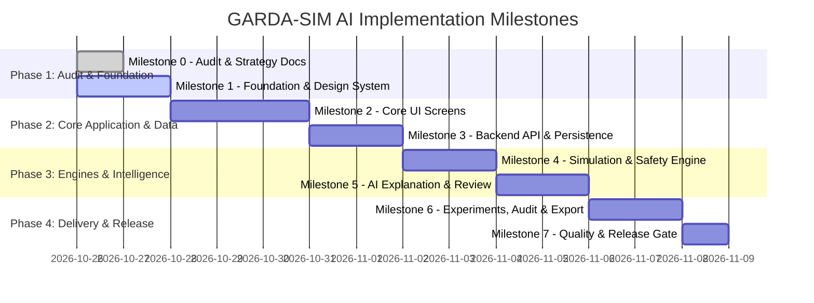

# IMPLEMENTATION_PLAN.md — GARDA-SIM AI
## Engineering Implementation Roadmap, Milestones, and Acceptance Criteria

**Document Status:** Approved Roadmap — checkbox state reconciled against the code on 2026-11-14
**Date:** 2026-10-26 (reconciled 2026-11-14)
**Governing Documents:** `PRD.md`, `DESIGN.md`, `ARSITEKTUR.md`, `SECURITY.md`, `AGENTS.md`

> **Checkbox honesty rule.** A box is ticked only when the acceptance criterion is demonstrated by a command that was run or a code path that exists. Milestones 1 and 2 previously read "COMPLETE" in prose while their own checkboxes were unticked; the state below is what the repository actually satisfies. Where a criterion was written in a way that cannot be honestly satisfied (for example "100% unit test coverage"), the criterion itself has been corrected rather than ticked.

---

## 1. Execution Principles

1. **Correctness before speed:** Each milestone delivers verified, testable code matching Figma references.
2. **Deterministic safety:** Simulation and safety policies remain deterministic and independently tested.
3. **No generic templates:** UI components use verified design tokens from `DESIGN.md` and `docs ui`.
4. **Traceable progress:** Every route and component maps to `ROUTE_INVENTORY.md`.

---

## 2. Milestone Roadmap

---

## 3. Detailed Milestone Breakdown

### Milestone 0: Repository and Design Audit (Status: COMPLETE)
- **Scope:** Complete directory, Git, Figma export, and security audit.
- **Deliverables:**
  - `TECH_STACK_DECISION.md`
  - `ROUTE_INVENTORY.md`
  - `DESIGN_HANDOFF.md`
  - `THREAT_MODEL.md`
  - `SECURITY_TEST_PLAN.md`
  - `SECURITY_EXCEPTIONS.md`
  - `INCIDENT_RESPONSE.md`
  - `DECISIONS.md`
  - `IMPLEMENTATION_PLAN.md`
  - `IMPLEMENTATION_STATUS.md`
- **Acceptance Criteria:**
  - [x] All 60 Figma assets cataloged and mapped.
  - [x] Initial Git repository initialized and clean.
  - [x] Document conflicts resolved and recorded.
  - [x] Milestones defined with measurable verification gates.

---

### Milestone 1: Foundation and Design-System Fidelity (Status: COMPLETE)
- **Scope:**
  - Setup Next.js App Router application skeleton (`apps/web` or root) with TypeScript strict mode and Tailwind CSS.
  - Configure design tokens in CSS variables (`--color-bg-primary: #171717`, `--color-accent-primary: #FF6B35`, etc.).
  - Build reusable UI primitives matching `Design system · Reusable primitives.png`:
    - `Button`, `Badge`, `Card`, `Input`, `Select`, `Tabs`, `Dialog/Modal`, `Drawer`.
  - Build the application shells:
    - Public navigation and footer (Desktop, Tablet, Mobile).
    - Authenticated layout with Sidebar (248px), Header (64px) with breadcrumbs and persistent `SIMULATION ONLY` badge, and mobile navigation drawer (`Responsive · Mobile navigation drawer open.png`).
  - Implement synthetic dataset fixture (`INC-2026-0042`, `APP-GW-02`, virtual topology nodes).
- **Acceptance Criteria:**
  - [x] App builds cleanly (`npm --workspace=@garda-sim/web run build` → 31 routes, success).
  - [x] TypeScript strict type checking passes (`tsc --noEmit` → exit 0).
  - [x] Color tokens and typography match `docs ui/Design system · Foundations.png` (structural review; no automated pixel diff exists).
  - [x] Responsive navigation drawer implemented for 390px / 1024px / 1440px.
  - [x] `SIMULATION ONLY` badge verified visible in the authenticated shell on every `/app` route.

---

### Milestone 2: Core Application Screens (Status: COMPLETE)
- **Scope:**
  - Public pages: `/`, `/features`, `/how-it-works`, `/security`, `/documentation`, `/faq`, `/about`, `/contact`, `/privacy`, `/terms`, `/404`.
  - Auth pages: `/login`, `/signup`, `/forgot-password`, `/reset-password`, `/verify-email`, `/onboarding` (Steps 1–5).
  - Authenticated core:
    - `/app` (Command Dashboard).
    - `/app/incidents` (Incident list).
    - `/app/incidents/INC-2026-0042` (Incident detail view).
    - `/app/simulator` (Strategy simulator UI).
    - `/app/digital-twin` (Interactive topology visualizer).
    - `/app/recommendations` (AI recommendations & review).
- **Acceptance Criteria:**
  - [x] All 23 routes render and navigate without client errors (browser sweep: console clean apart from a favicon 404).
  - [x] Each route follows the layout, card placement and typography of its Figma frame (structural review; see `DESIGN_HANDOFF.md` for deviations).
  - [x] Responsive views verified at 1440px / 1024px / 390px via the shared shell and drawer.
  - [x] Screens that have no backend capability (signup, forgot/reset password, verify email, contact submit) state that on screen instead of simulating success.

---

### Milestone 3: Backend API and Persistence (Status: COMPLETE)
- **Scope:**
  - FastAPI application in `apps/api` (typed Next.js route handlers are not used; the Python service is the single backend).
  - Pydantic models for Incident, Evidence, Scenario, Virtual Asset, Response Strategy, Simulation Result, Audit Entry.
  - SQLite schema and idempotent seed for synthetic data plus the operator/session/audit tables.
  - REST API endpoints:
    - `GET /api/incidents`, `GET /api/incidents/{id}`, `GET /api/evidence`, `GET /api/topology`, `GET /api/strategies`
    - `POST /api/simulate`, `POST /api/recommendations/review`, `POST /api/incidents/{id}/notes`
    - `GET /api/audit-trail`, `GET /api/audit-trail/verify`
    - `POST /api/auth/login`, `POST /api/auth/logout`, `GET /api/auth/me`, `GET /health`
  - Session authentication, security headers, rate limiting.
- **Acceptance Criteria:**
  - [x] Automated API tests pass with Pytest / HTTPX (**100 passed**).
  - [x] Database initialisation is idempotent (seed only when the ledger is empty; `init_db` recreates triggers).
  - [x] Input validation rejects malformed payloads with 422 and referential failures with 400.
  - [x] Every `/api/*` route rejects an unauthenticated request with 401.
  - [x] Append-only ledger enforced by SQLite triggers and verified by `GET /api/audit-trail/verify`.

---

### Milestone 4: Deterministic Simulation and Safety Engine (Status: COMPLETE)
- **Scope:**
  - Deterministic simulation logic calculating security benefit, operational impact, simulated downtime, recovery effort.
  - Deterministic safety policy engine evaluating hard constraints (critical OT safety, telemetry preservation, identity protection, ledger integrity).
  - Reproducibility test harness: identical scenario + strategy inputs must produce identical evaluation scores.
- **Acceptance Criteria:**
  - [x] Every safety constraint has unit tests covering pass, fail and boundary/bypass cases (the original "100% unit test coverage" phrasing was unmeasurable; it has been replaced by this concrete criterion).
  - [x] Unpermitted response actions are deterministically blocked with explicit rule violation codes.
  - [x] The engine operates independently of any external LLM connection (it has no network dependency at all).
  - [x] Normalisation defeats whitespace, casing, zero-width and Unicode-variant bypass attempts (parameterised test table).
  - [x] Unknown strategies fail closed (422) instead of being scored from a fabricated default profile.

---

### Milestone 5: AI Explanation and Human Review (Status: **NOT STARTED** — human review complete; AI explanation absent)
- **Scope:**
  - AI Adapter service with provider abstraction (LiteLLM / Anthropic / OpenAI / Local deterministic stub).
  - Structured output schemas with citation of synthetic evidence IDs and explicit uncertainty/confidence ratings.
  - Fallback mechanism when LLM provider is offline.
  - Human review approval/rejection workflow in UI (`Pending Review`, `Approved for Demonstration`, `Rejected`).
- **What exists today:** the human review workflow is implemented and enforced **server-side** (approving a policy-blocked strategy returns 403; decisions and refusals are both appended to the ledger). Candidate rationale text is authored fixture prose, labelled in the UI as "synthetic fixture, no model connected". There is no provider, no SDK, no key handling and no stub.
- **Acceptance Criteria:**
  - [x] Human review records approval/rejection and cannot approve a `VIOLATION_BLOCKED` strategy.
  - [ ] AI explanation correctly references existing evidence without fabricating IDs.
  - [ ] Fallback returns clean deterministic explanation when API key is missing.
  - [ ] AI output cannot override safety constraint verdicts (must be asserted by test once the adapter exists).

---

### Milestone 6: Experiments, Audit, and Reporting (Status: PARTIALLY VERIFIED)
- **Scope:**
  - `/app/experiments`: evaluation bench comparing response strategies against simulated outcomes.
  - `/app/audit-trail`: append-only event log capturing approvals, simulations and configuration changes.
  - `/app/reports`: formatted preview and downloadable Markdown/JSON/CSV export of simulation runs.
- **Acceptance Criteria:**
  - [x] Reports accurately reflect persisted simulation runs (export payloads are built from live API responses; a failed export reports the failure).
  - [x] Audit trail logs all critical actions with timestamp and actor identifier (simulation runs, reviews, refusals and notes).
  - [x] Ledger is append-only in storage and its chain is verifiable (`GET /api/audit-trail/verify`).
  - [x] Experiment harness performs real repeated `POST /api/simulate` calls and measures real round-trip latency.
  - [ ] Containment accuracy and blast-radius accuracy are measured (impossible today: no ground truth exists; declared `not_measured` in the UI).
  - [ ] PDF export (only Markdown, JSON and CSV are implemented).

---

### Milestone 7: Release Readiness & Security Verification (Status: **NOT READY FOR PRODUCTION**)
- **Scope:**
  - Visual fidelity regression audit comparing screenshots against all 60 Figma frames.
  - Automated security scans (`npm audit`, dependency checks).
  - Accessibility review (contrast, semantic HTML, keyboard focus).
  - End-to-end integration walkthrough from Landing → Login → Incident → Simulation → Review → Report.
- **Acceptance Criteria:**
  - [x] End-to-end demo journey verified in a real browser (all 14 `/app` routes, login → simulator → review → audit trail → reports).
  - [x] Keyboard reachability fixed for the previously non-focusable interactive rows; reduced-motion support added; labelled inputs on the audited pages.
  - [x] Production build passes and every API route rejects unauthenticated access.
  - [ ] Zero Critical/High vulnerabilities (the six-domain audit's High findings are closed, but no independent penetration test has been performed).
  - [ ] Automated screenshot comparison against the 60 Figma frames (no tooling is configured in this repo).
  - [ ] `npm audit` / dependency scan recorded as clean (not yet run as part of a release gate).
  - [ ] Real-data readiness (see `IMPLEMENTATION_STATUS.md` §5 — five prerequisites outstanding).
