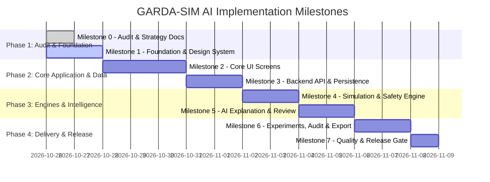

# IMPLEMENTATION_PLAN.md — GARDA-SIM AI
## Engineering Implementation Roadmap, Milestones, and Acceptance Criteria

**Document Status:** Approved Roadmap  
**Date:** 2026-10-26  
**Governing Documents:** `PRD.md`, `DESIGN.md`, `ARSITEKTUR.md`, `SECURITY.md`, `AGENTS.md`

---

## 1. Execution Principles

1. **Correctness before speed:** Each milestone delivers verified, testable code matching Figma references.
2. **Deterministic safety:** Simulation and safety policies remain deterministic and independently tested.
3. **No generic templates:** UI components use verified design tokens from `DESIGN.md` and `docs ui`.
4. **Traceable progress:** Every route and component maps to `ROUTE_INVENTORY.md`.

---

## 2. Milestone Roadmap

---

## 3. Detailed Milestone Breakdown

### Milestone 0: Repository and Design Audit (Status: COMPLETE)
- **Scope:** Complete directory, Git, Figma export, and security audit.
- **Deliverables:**
  - `TECH_STACK_DECISION.md`
  - `ROUTE_INVENTORY.md`
  - `DESIGN_HANDOFF.md`
  - `THREAT_MODEL.md`
  - `SECURITY_TEST_PLAN.md`
  - `SECURITY_EXCEPTIONS.md`
  - `INCIDENT_RESPONSE.md`
  - `DECISIONS.md`
  - `IMPLEMENTATION_PLAN.md`
  - `IMPLEMENTATION_STATUS.md`
- **Acceptance Criteria:**
  - [x] All 60 Figma assets cataloged and mapped.
  - [x] Initial Git repository initialized and clean.
  - [x] Document conflicts resolved and recorded.
  - [x] Milestones defined with measurable verification gates.

---

### Milestone 1: Foundation and Design-System Fidelity (Status: IN PROGRESS)
- **Scope:**
  - Setup Next.js App Router application skeleton (`apps/web` or root) with TypeScript strict mode and Tailwind CSS.
  - Configure design tokens in CSS variables (`--color-bg-primary: #171717`, `--color-accent-primary: #FF6B35`, etc.).
  - Build reusable UI primitives matching `Design system · Reusable primitives.png`:
    - `Button`, `Badge`, `Card`, `Input`, `Select`, `Tabs`, `Dialog/Modal`, `Drawer`.
  - Build the application shells:
    - Public navigation and footer (Desktop, Tablet, Mobile).
    - Authenticated layout with Sidebar (248px), Header (64px) with breadcrumbs and persistent `SIMULATION ONLY` badge, and mobile navigation drawer (`Responsive · Mobile navigation drawer open.png`).
  - Implement synthetic dataset fixture (`INC-2026-0042`, `APP-GW-02`, virtual topology nodes).
- **Acceptance Criteria:**
  - [ ] App builds cleanly (`npm run build`).
  - [ ] Lint and TypeScript type checking pass (`npm run lint`, `tsc --noEmit`).
  - [ ] Color tokens and typography match `docs ui/Design system · Foundations.png`.
  - [ ] Responsive navigation drawer works smoothly at 390px, 1024px, and 1440px.
  - [ ] `SIMULATION ONLY` banner verified visible in authenticated shell.

---

### Milestone 2: Core Application Screens
- **Scope:**
  - Public pages: `/`, `/features`, `/how-it-works`, `/security`, `/documentation`, `/faq`, `/about`, `/contact`, `/privacy`, `/terms`, `/404`.
  - Auth pages: `/login`, `/signup`, `/forgot-password`, `/reset-password`, `/verify-email`, `/onboarding` (Steps 1–5).
  - Authenticated core:
    - `/app` (Command Dashboard).
    - `/app/incidents` (Incident list).
    - `/app/incidents/INC-2026-0042` (Incident detail view).
    - `/app/simulator` (Strategy simulator UI).
    - `/app/digital-twin` (Interactive topology visualizer).
    - `/app/recommendations` (AI recommendations & review).
- **Acceptance Criteria:**
  - [ ] All 23 routes render and navigate without client errors.
  - [ ] Each route accurately represents the layout, card placements, and typography of its Figma frame.
  - [ ] Responsive views verified at 1440px, 1024px, 390px.

---

### Milestone 3: Backend API and Persistence
- **Scope:**
  - FastAPI application in `apps/api` (or integrated typed Next.js route handlers with Python domain service).
  - Pydantic models for Incident, Evidence, Scenario, Virtual Asset, Response Strategy, Simulation Result, Audit Entry.
  - SQLite/PostgreSQL schema and seed migration scripts for synthetic data.
  - REST API endpoints:
    - `GET /api/scenarios`, `GET /api/incidents`, `GET /api/incidents/{id}`
    - `GET /api/topology`, `POST /api/simulate`
    - `POST /api/recommendations/review`, `GET /api/audit-trail`
- **Acceptance Criteria:**
  - [ ] Automated API tests pass with Pytest / HTTPX.
  - [ ] Database seeds load idempotently.
  - [ ] Input validation rejects malformed payloads with 422 Unprocessable Entity.

---

### Milestone 4: Deterministic Simulation and Safety Engine
- **Scope:**
  - Deterministic simulation logic calculating security benefit, operational impact, simulated downtime, recovery effort.
  - Deterministic safety policy engine evaluating hard constraints (e.g. Critical OT safety rules, telemetry preservation, isolated containment policies).
  - Reproducibility test harness: identical scenario + strategy seeds must produce identical evaluation scores.
- **Acceptance Criteria:**
  - [ ] 100% unit test coverage on safety constraints.
  - [ ] Unpermitted response actions are deterministically blocked with clear rule violation codes.
  - [ ] Engine operates independently of any external LLM connection.

---

### Milestone 5: AI Explanation and Human Review
- **Scope:**
  - AI Adapter service with provider abstraction (LiteLLM / Anthropic / OpenAI / Local deterministic stub).
  - Structured output schemas with citation of synthetic evidence IDs and explicit uncertainty/confidence ratings.
  - Fallback mechanism when LLM provider is offline.
  - Human review approval/rejection workflow in UI (`Pending Review`, `Approved for Demonstration`, `Rejected`).
- **Acceptance Criteria:**
  - [ ] AI explanation correctly references existing evidence without fabricating IDs.
  - [ ] Fallback returns clean deterministic explanation when API key is missing.
  - [ ] AI output cannot override safety constraint verdicts.

---

### Milestone 6: Experiments, Audit, and Reporting
- **Scope:**
  - `/app/experiments`: Evaluation bench comparing baseline response strategies vs simulated outcomes.
  - `/app/audit-trail`: Immutable event log capturing user approvals, simulations, and config changes.
  - `/app/reports`: Formatted preview and downloadable markdown/JSON/PDF export of simulation runs.
- **Acceptance Criteria:**
  - [ ] Reports accurately reflect persisted simulation runs.
  - [ ] Audit trail logs all critical actions with timestamp and user identifier.

---

### Milestone 7: Release Readiness & Security Verification
- **Scope:**
  - Visual fidelity regression audit comparing screenshots against all 60 Figma frames.
  - Automated security scans (`npm audit`, dependency checks).
  - Accessibility review (contrast, semantic HTML, keyboard focus).
  - End-to-end integration walkthrough from Landing -> Login -> Onboarding -> Incident -> Sim -> Review -> Report.
- **Acceptance Criteria:**
  - [ ] Zero Critical/High vulnerabilities.
  - [ ] All checklist items in `SECURITY_TEST_PLAN.md` verified.
  - [ ] Full demo journey verified in browser.
