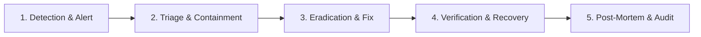

# INCIDENT_RESPONSE.md — GARDA-SIM AI
## Application Incident Response and Security Escalation Procedure

**Document Status:** Operational Baseline  
**Date:** 2026-10-26  
**Governing Documents:** `SECURITY.md`, `AGENTS.md`

---

## 1. Scope & Objective

This document defines the escalation and response procedures in the event of an operational, application security, or data integrity incident affecting the GARDA-SIM AI platform.

---

## 2. Incident Classification & Severity

| Severity | Definition | Target Triage Time | Target Containment |
|---|---|---|---|
| **P1 - Critical** | Secret exposure, authentication bypass, remote code execution, database compromise | < 30 minutes | < 2 hours |
| **P2 - High** | Cross-user data access, deterministic safety engine bypass, broken audit logging | < 2 hours | < 8 hours |
| **P3 - Medium** | Denial of service on non-critical endpoints, UI disclosure of internal error messages | < 8 hours | < 24 hours |
| **P4 - Low** | Minor cosmetic defect, non-exploitable configuration warning | < 24 hours | Next release |

---

## 3. Incident Lifecycle

1. **Detection & Triage:** Identify scope, affected components, and whether real secrets or user data are impacted.
2. **Containment:** If secrets were leaked, immediately revoke and rotate API keys and tokens. If an endpoint is vulnerable, disable or block the route via web server config.
3. **Eradication:** Deploy a patched code release with regression tests verifying the fix.
4. **Recovery:** Verify system state, run full test suite, validate audit log continuity.
5. **Post-Mortem:** Document root cause, timeline, impact, and preventative actions within 72 hours.
